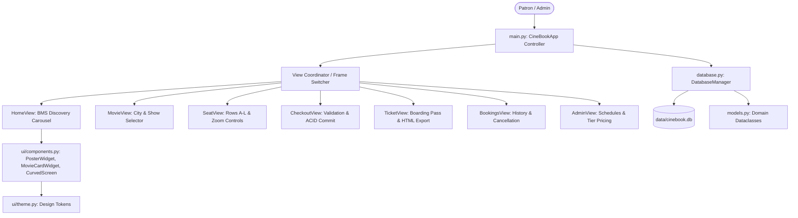

# CineBook — Comprehensive Viva Voce & Demonstration Guide
### Advanced Programming Practice | Python Tkinter & SQLite3 Desktop Application

This document provides a complete guide for presenting the **CineBook Indian Movie Ticket Booking System** to academic evaluators, external viva examiners, and project juries.

---

## 🎯 1. Three-Minute Evaluator Presentation Script

> *"Good morning, respected examiners. Today I am demonstrating **CineBook Pro**, an authentic Indian movie ticket reservation desktop application built in Python using **Tkinter/ttk** for the user interface, **SQLite3** for ACID-compliant persistence, and **Pillow** for rendering verified theatrical poster artwork.*
>
> *Our project is specifically architected around a realistic 7-tier cinema hierarchy:*
> **City → Demonstration Theatre → Auditorium Screen → Movie → Date → Showtime → Seats**
>
> *Key technical highlights of our implementation:*
> 1. **BookMyShow-Style Light Theme (`#F2F4F8`)**: We moved away from dark/generic themes to a clean, crisp, multi-city Indian cinema discovery experience featuring a live search bar, city selector (`Chennai`, `Hyderabad`, `Bengaluru`, `Mumbai`, `Kochi`), category chips, and a 5-card portrait movie carousel.
> 2. **Authentic Theatrical Posters & Provenance**: Unlike basic student projects that use abstract shapes or random images, CineBook Pro integrates authentic theatrical release posters for 20 verified Indian films across **Telugu, Tamil, Hindi, Malayalam, and Kannada** industries. All posters are stored locally in `assets/posters/` with a formal JSON manifest (`posters_manifest.json`) recording source provenance, dimensions, and aspect ratio. An in-memory cache and `ImageOps.fit` ensure sharp portrait scaling without stretching or repeated disk reads, while a graceful fallback handles unreleased titles.
> 3. **Complete Demo Booking for Every Movie**: Every single movie card in the catalogue supports complete end-to-end booking. If any title has no configured showtimes, an empty-state card offers an instant `[⚡ Add Demonstration Showtimes]` button that dynamically populates multi-screen schedules on demand.
> 4. **Spacious Auditorium Layout (Rows A–L, 96 Seats)**: Accommodates three distinct comfort tiers (**Recliner, Elite, Normal**) with section headers and pricing bands displayed above each category, separate left/right blocks with a central walkway aisle, green highlights for selected seats (`#10B981`), amber bestseller borders, theatre screen indicator at the bottom with a curved arc, zoom controls (`[🔍+]`, `[🔍-]`, `[↺ Reset]`), and a fixed legend.
> 5. **Concurrency & Double-Booking Protection**: We implemented atomic SQLite transactions (`with conn:` and `WHERE status = 'AVAILABLE'`). If two patrons select the same seat concurrently, the transaction enforces immediate rollback, preventing duplicate ticket issuance.
> 6. **Checkout & Boarding Pass Tickets**: Validates 10-digit Indian mobile numbers and customer credentials, itemizes ticket rates plus a transparent ₹25 convenience fee, presents a pre-confirmation summary modal, issues unique alphanumeric references (`CB-2026-XXXXX`), and exports digital boarding-pass receipts as both formatted HTML and Plain Text.
> 7. **Operations & Admin Console**: Includes a demo administrative view for managing screening formats (IMAX Laser 3D, Dolby Atmos 4K, Luxe Lounge), show schedules, and live seat pricing tiers.
>
> *I will now demonstrate the application running live and execute our automated test suite comprising 28 test cases.*"

---

## 🏗️ 2. Architectural Design Patterns

CineBook strictly adheres to professional desktop software engineering principles:



### Key Design Patterns Implemented:
1. **Model-View-Controller (MVC)**:
   - **Model**: `models.py` (`Movie`, `Show`, `Seat`, `Booking`, `City`, `Theatre`, `Screen`) and `database.py`.
   - **View**: `ui/home_view.py`, `ui/movie_view.py`, `ui/seat_view.py`, `ui/checkout_view.py`, `ui/ticket_view.py`, `ui/bookings_view.py`, `ui/admin_view.py`.
   - **Controller**: `main.py` (`CineBookApp`) orchestrates view transitions, shared state (e.g. selected city), and modal lifecycles.
2. **Repository Pattern**: `DatabaseManager` encapsulates all SQL queries, foreign key enforcements, and transactional boundary logic away from UI widgets.
3. **In-Memory Image Caching**: `ui/components.py` maintains `_POSTER_CACHE: Dict[Tuple[str, int, int], ImageTk.PhotoImage]` to eliminate redundant file I/O and Lanczos resampling during carousel scrolling and view transitions.
4. **Graceful Degradation / Fallback Pattern**: If an image asset is missing, `PosterWidget` draws a professional, clearly labeled `[🎬 POSTER UNAVAILABLE / Theatrical Artwork Pending]` state rather than failing or drawing misleading synthetic art.

---

## 🗄️ 3. Relational Database Schema & Hierarchy

CineBook uses a normalized relational SQLite database with strict foreign keys (`PRAGMA foreign_keys = ON;`):

| Table | Primary Key | Foreign Keys | Key Constraints & Purpose |
|---|---|---|---|
| `cities` | `id` | None | `name UNIQUE NOT NULL`. 5 Major Indian Hubs (Chennai, Hyderabad, Bengaluru, Mumbai, Kochi). |
| `theatres` | `id` | `city_id` → `cities(id)` | 15 Demonstration Theatres (3 per city). `ON DELETE CASCADE`. |
| `screens` | `id` | `theatre_id` → `theatres(id)` | 45 Auditoriums (IMAX Laser 3D, Dolby Atmos 4K, Luxe Lounge). |
| `movies` | `id` | None | 20 Factual Indian Films. Stores duration, censor rating, language, industry, rating, votes, and poster path. |
| `shows` | `id` | `movie_id`, `screen_id` | Schedules linking a movie, screen format, date, and showtime with tier pricing (`price_classic`, `price_elite`, `price_recliner`). |
| `show_seats` | `id` | `show_id`, `booking_id` | `UNIQUE(show_id, seat_number)`. Prevents duplicate seat records per show. |
| `bookings` | `id` | `show_id` → `shows(id)` | `booking_ref UNIQUE NOT NULL`. Stores customer contact, itemized price breakdown, and booking status. |
| `booking_seats` | `id` | `booking_id` → `bookings(id)` | Junction table recording seat items, tiers, and snapshot prices per reservation. |

---

## 🔒 4. Concurrency & ACID Double-Booking Prevention

### The Concurrency Problem:
In a multi-user or high-demand cinema booking system, two users might select seat **F4** at the same time and attempt to pay simultaneously. Without atomic database isolation, both transactions might write, leading to an illegal double-booking.

### CineBook's Solution:
1. **Immediate Pre-Commit Verification**: When `create_booking()` is invoked, a database transaction is initiated (`with conn:`).
2. **Atomic Inventory Re-check**: The query re-verifies that every requested seat has `status = 'AVAILABLE'` for the exact `show_id`.
3. **Lock & Commit**:
   ```sql
   UPDATE show_seats
   SET status = 'BOOKED', booking_id = ?
   WHERE show_id = ? AND seat_number = ? AND status = 'AVAILABLE';
   ```
4. **Integrity Validation**: If `cursor.rowcount < len(requested_seats)`, another transaction has claimed a seat. `SeatUnavailableError` is immediately raised, causing an automatic `ROLLBACK` of all changes.
5. **Idempotency**: Seats are only committed if all seats in the customer's cart succeed together.

---

## 🎨 5. Theatrical Poster Pipeline & Manifest

- **Storage Location**: `assets/posters/`
- **Manifest File**: `assets/posters/posters_manifest.json`
- **Industries Covered**:
  - **Telugu Cinema**: *RRR*, *Baahubali 2: The Conclusion*, *Pushpa 2: The Rule*, *Kalki 2898 AD*, *Hanu-Man*
  - **Tamil Cinema**: *Leo: Bloody Sweet*, *Vikram: Hitlist*, *Jailer*, *Ponniyin Selvan: Part 1*
  - **Hindi / Bollywood**: *Jawan*, *12th Fail*, *Dangal*, *Stree 2: Sarkate Ka Aatank*
  - **Malayalam Cinema**: *Manjummel Boys*, *Aavesham*, *Lucifer*
  - **Kannada Cinema**: *K.G.F: Chapter 2*, *Kantara: A Legend*, *777 Charlie*, *Kantara: Chapter 1 (Prequel)*
- **Quality & Aspect Ratio**: Standard portrait ratio (~1:1.5 or 2:3) preserved via Pillow's `ImageOps.fit()`.

---

## ❓ 6. Top 25 Viva Voce Questions & Answers

### Python & Tkinter Architecture
1. **Q: Why did you choose Tkinter over a web framework for this project?**  
   *A: Tkinter is the standard Python desktop GUI library, providing native windowing, cross-platform performance, zero server-side latency, and full offline functionality without external runtime servers.*

2. **Q: How is the application view switching implemented without creating multiple root windows?**  
   *A: We utilize a Single Window Multi-Frame architecture. `main.py` contains a master `container` frame. Whenever a navigation action occurs, the current child view is destroyed or unmounted, and the new view class (e.g. `SeatView`) is instantiated inside the container.*

3. **Q: What is the purpose of `ttk` over standard `tk` widgets?**  
   *A: `ttk` (Themed Tkinter) separates widget logic from styling. We use `ttk.Treeview`, `ttk.Combobox`, and `ttk.Scrollbar` themed to match the clean BookMyShow light grey style (`#F2F4F8`).*

4. **Q: How does the movie card carousel achieve horizontal multi-page scrolling?**  
   *A: In `ui/home_view.py`, we track `self.carousel_page` (5 cards per page). Clicking `‹` or `›` increments/decrements the index and calls `_render_carousel_page()`, dynamically redrawing the 5 visible cards from the active movie list.*

5. **Q: How are movie posters prevented from lagging the UI during re-renders?**  
   *A: We implemented an in-memory dictionary cache `_POSTER_CACHE[(path, width, height)]` in `ui/components.py`. Once an image is opened, resized via Lanczos resampling, and wrapped as a `PhotoImage`, it is reused instantly without disk I/O.*

### Database & Concurrency
6. **Q: Why did you use SQLite and how is foreign key integrity enabled?**  
   *A: SQLite is serverless, zero-configuration, and ACID-compliant. By default, SQLite disables foreign keys for backward compatibility, so we explicitly execute `PRAGMA foreign_keys = ON;` on every connection.*

7. **Q: How is double-booking prevented in the database?**  
   *A: We use a compound unique constraint `UNIQUE(show_id, seat_number)` on the `show_seats` table and execute the reservation within a transactional context (`with conn:`). The update explicitly verifies `WHERE status = 'AVAILABLE'` before writing.*

8. **Q: What happens if a customer cancels a booking?**  
   *A: Cancellation is transactional: the booking record status is updated to `CANCELLED` and its `cancelled_at` timestamp is recorded for historical auditing, while all associated rows in `show_seats` are updated back to `AVAILABLE` with `booking_id = NULL`.*

9. **Q: What is the hierarchy from city to seat in your schema?**  
   *A: `City` (e.g., Hyderabad) → `Theatre` (e.g., CineBook PVR) → `Screen` (e.g., IMAX Laser 3D) → `Movie` (e.g., RRR) → `Show` (Date + Time) → `Seat` (e.g., Row A Seat 1).*

10. **Q: Can different shows reuse the same physical seat?**  
    *A: Yes. Physical seat geometry is defined per screen, but inventory exists in `show_seats` per `show_id`. Show A at 10:30 AM and Show B at 6:45 PM have separate rows for seat "A1", allowing independent booking.*

### Seating Matrix & Calculations
11. **Q: How are Rows A to L arranged in the seat selection screen?**  
    *A: There are 12 rows (A through L) with 8 seats per row (total 96 seats per screen). A 24-pixel central aisle separates seats 1-4 from seats 5-8, simulating a realistic theatre walking path.*

12. **Q: What are the three seat categories and their pricing?**  
    *A: Rows A–B are **Recliner** (Top tier, default ₹300), Rows C–F are **Elite** (Middle tier, default ₹220), and Rows G–L are **Normal** (Standard tier, default ₹150). Each category displays its label and price above the section (e.g. `RECLINER - Rs. 300.00`).*

13. **Q: How are selected seats visually identified and how does the bottom screen indicator work?**  
    *A: Selected seats immediately turn **Emerald Green (`#10B981`)** with white seat numbers upon click, matching the user reference design. Bestseller seats in prime rows are highlighted with an amber border (`#F59E0B`). At the bottom of the seat chart, a curved cinema screen arc displays `• ALL EYES THIS WAY PLEASE (SCREEN) •`.*

14. **Q: How does the zoom-in and zoom-out feature work in `SeatView`?**  
    *A: In `ui/seat_view.py`, buttons `[🔍+]` and `[🔍-]` adjust `self.current_seat_size` (between 26px and 48px). When triggered, `_apply_zoom()` iterates through all active `SeatWidget` instances, calling `set_size()`, which resizes both the canvas button and font.*

15. **Q: How is the maximum seat limit enforced?**  
    *A: When a user clicks an available seat, `_toggle_seat_selection()` checks `if len(self.selected_seat_numbers) >= MAX_SEATS_PER_BOOKING (6)`. If reached, it displays a friendly warning alert without selecting the seat.*

16. **Q: How is the total price calculated?**  
    *A: `Grand Total = Subtotal (sum of individual seat tier prices) + ₹25 Flat Convenience Fee` in Indian Rupees.*

### Image Processing & Fallbacks
17. **Q: How does Pillow ensure that movie posters do not get stretched?**  
    *A: We use `ImageOps.fit(im, (target_w, target_h), method=Image.Resampling.LANCZOS)`, which calculates the scale factor to fill the box while preserving the source aspect ratio and cropping excess margins symmetrically.*

18. **Q: What happens if a poster file is corrupt or unreleased?**  
    *A: `PosterWidget._draw_unavailable_fallback()` draws a dark cinema card with a film clapper icon `🎬`, the label `POSTER UNAVAILABLE`, and `Theatrical Artwork Pending`. No synthetic AI shapes or random images are substituted.*

19. **Q: Where is the provenance and source URL of each poster documented?**  
    *A: In `assets/posters/posters_manifest.json`, which contains the film title, industry, release year, local filename, direct source URL, and license notice.*

### Customer Checkout & Digital Tickets
20. **Q: What client-side input validation is enforced during checkout?**  
    *A: Customer Name ($\ge 2$ characters, alphabets and spaces only), Customer Phone (exactly 10 digits matching Indian mobile regex `^[6-9]\d{9}$`), and optional Email (valid email regex).*

21. **Q: How is the booking reference generated?**  
    *A: Using `datetime.now().strftime("%Y")` and a cryptographically pseudorandom 6-character uppercase alphanumeric suffix (e.g. `CB-2026-K9P2X7`).*

22. **Q: In what formats can the ticket be saved?**  
    *A: In `ui/ticket_view.py`, `_export_ticket()` writes both a cleanly formatted **Plain Text (`.txt`)** receipt and a styled **HTML (`.html`)** digital pass into the `exports/` directory.*

### Operations & Testing
23. **Q: What does the Demo Administration Console do?**  
    *A: Accessible via the top navbar (`⚙ Demo Admin`), `AdminView` displays platform statistics, an interactive Treeview of cities/theatres/screens, and an active show ticket price adjuster that updates Classic, Elite, and Recliner prices in real time.*

24. **Q: How many automated tests exist and what do they verify?**  
    *A: 28 automated tests across 3 test suites (`test_booking_logic.py`, `test_gui_headless.py`, `test_redesign_verification.py`), verifying database initialization, idempotency, search, tier pricing, transactions, cancellations, double-booking prevention, headless view mounting, green seat selection, and all 5 Indian cinema industries.*

25. **Q: What command launches the CineBook application?**  
    *A: `python main.py`.*

---

## 🎬 7. Live Demonstration Script Walkthrough

Follow this exact walkthrough step-by-step during project demonstration:

1. **Launch Application**:
   ```bash
   python main.py
   ```
   Show the BookMyShow-style light-themed discovery homepage with signature coral-red accents, search bar, city dropdown (`Chennai`), language filter pills (`Telugu`, `Tamil`, `Hindi`, `Malayalam`, `Kannada`), and the 5-card carousel.

2. **Select Any Indian Movie**:
   - Filter by language (e.g. click `Telugu` or `Tamil` or `Kannada`).
   - Click `Book Tickets` on any movie card (e.g. *RRR*, *Jailer*, or *Kantara*).

3. **Choose City, Theatre, and Showtime**:
   - Demonstrate switching between cities (`Chennai`, `Hyderabad`, `Bengaluru`, `Mumbai`, `Kochi`).
   - Choose a screening date tab and select a showtime slot (e.g. `🕒 06:45 PM` in `IMAX Laser 3D`).
   - Note the demonstration notice banner clearly disclosing sample data.

4. **Interactive Seat Selection (Matches Reference Screenshot)**:
   - Click `Select Seats →` to open the auditorium layout.
   - Point out the **Rows A through L** labeled down the left, separated by a central walking aisle into left (1–4) and right (5–8) blocks.
   - Point out category banners above each section: `RECLINER - Rs. 300.00`, `ELITE - Rs. 220.00`, `NORMAL - Rs. 150.00`.
   - Point out the cinema screen indicator at the **bottom**: `• ALL EYES THIS WAY PLEASE (SCREEN) •`.
   - Click to select 2 available seats (e.g. `C3` and `C4`): verify they turn **Emerald Green (`#10B981`)**.
   - Note immediate live calculation on the right: Subtotal (₹440) + Convenience Fee (₹25) = Grand Total (₹465).
   - Demonstrate zoom controls (`[🔍+]`, `[🔍-]`, `[↺ Reset]`).
   - Demonstrate maximum limit by attempting to select more than 6 seats (displays friendly warning).

5. **Customer Details & Summary Confirmation**:
   - Click `Continue to Pay ₹465.00 →`.
   - Enter Customer Name (e.g. `Devashish Sharma`) and 10-digit mobile number (`9876543210`).
   - Click `Confirm Booking`: a confirmation summary modal pops up showing movie, theatre, screen, date, showtime, seats, customer, and total price.
   - Click `Yes`: atomic transaction commits to SQLite without double-booking contention.

6. **Digital Boarding Pass Ticket & Receipt Export**:
   - View the generated boarding pass ticket with unique reference (`CB-2026-XXXXX`), cinema screen format, customer details, and simulated barcode.
   - Click `💾 Save Ticket (HTML & Text)`: saves receipt files to `exports/`.

7. **My Bookings & Cancellation**:
   - Click `🎟 My Bookings` to view the booking in the searchable history table.
   - Select the booking and click `❌ Cancel Selected Booking`: confirm cancellation to release seats back to `AVAILABLE` status in SQLite while maintaining audit history.
